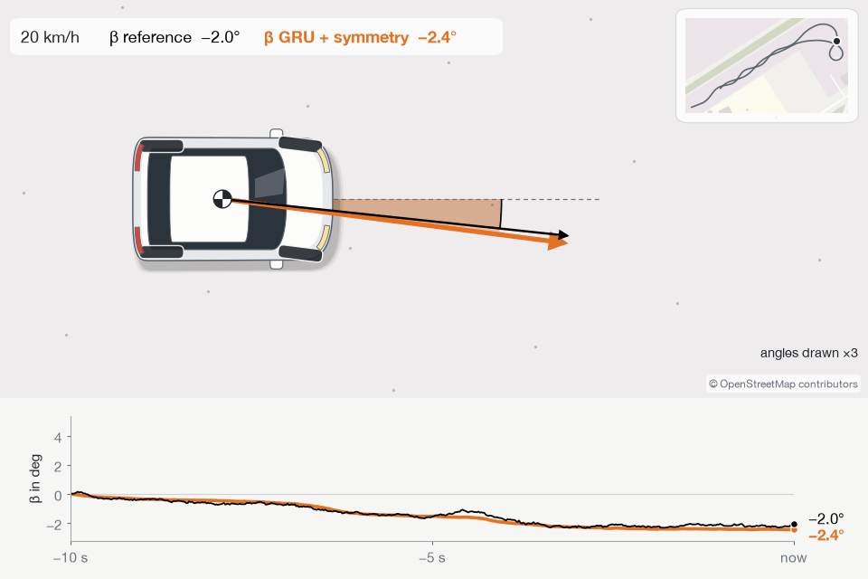
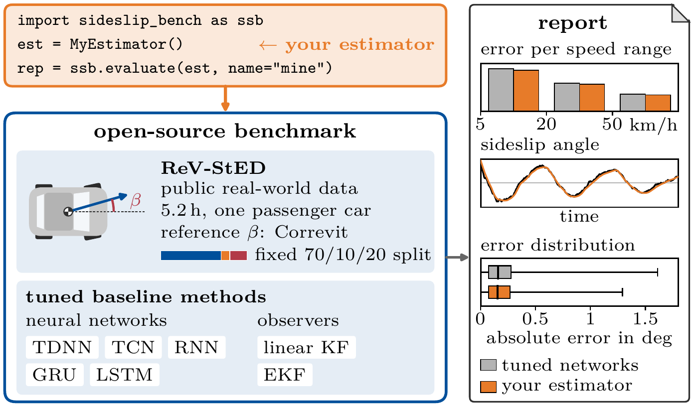

# sideslip_bench

<p align="center"></p>
<p align="center"><sub>The ReV-StED Smart in a slow corner: reference sideslip angle (black) and the GRU with built-in
mirror symmetry (orange). Angles in the scene are drawn ×3.</sub></p>

The sideslip angle β is the angle between where a car points and where it actually moves.
Stability control and automated driving rely on it, but series cars cannot measure it, so they
estimate it from onboard signals. sideslip_bench scores such estimators on the public ReV-StED
driving data under one fixed protocol, next to five tuned neural networks and two model-based
observers. It is the code release of the paper *An Open-Source Benchmark for Vehicle Sideslip
Angle Estimation*.

## How it works

You bring an estimator. The benchmark brings the data, the split and the comparison methods, and
returns a report.

<p align="center"></p>

## Install

```bash
git clone https://github.com/hschaefke/sideslip_bench && cd sideslip_bench
uv sync                  # core: data, evaluation, report, observers (no torch)
uv sync --extra train    # + PyTorch and tsfast, to run and train the networks
uv sync --extra anim     # + contextily, for the map behind the animation
```

Python 3.11 to 3.13. Run everything from the root of the clone: configs, weights and predictions
are files in it.

## Quick start

An estimator is a function that gets one test recording and returns β in degrees for every sample.

```python
import sideslip_bench as ssb

train = ssb.load("train")   # {recording: DataFrame} at 50 Hz; downloads ReV-StED on first use

def my_estimator(rec):      # rec: the nine CAN channels of one test recording
    return 0.0 * rec["speedo_obd"].to_numpy()   # beta in deg for every sample, causal

rep = ssb.evaluate(my_estimator, name="zero")   # report, metrics and table row in reports/zero/
print(rep["metrics"]["RMSE_g5"], rep["rank"])   # RMSE in deg, place among the shipped methods

gru = ssb.load_baseline("gru")  # shipped methods are estimators too (networks: --extra train)
```

`ssb.evaluate` also takes a dict `{recording: array}` or a folder of prediction files. From the
shell: `uv run python scripts/evaluate.py --preds my_estimator/test --name my_ukf`.
`scripts/animate.py` makes the animation at the top for any prediction folder:
`uv run --extra anim python scripts/animate.py --preds my_estimator/test --label "my UKF" --out runs/my_ukf.gif`.

<details>
<summary>Example report: the GRU with built-in mirror symmetry</summary>

Made with `ssb.evaluate("results/symmetric_preds/gru", name="gru_sym")`.


</details>

## Results

Test split, v_x ≥ 5 km/h, errors in deg. Each method ships as one model: the training seed with
the lowest validation RMSE. The paper reports the median over all seeds, so its numbers differ
([why](docs/DETAILS.md#comparison-methods)). Test predictions of the networks with built-in
mirror symmetry are bundled too ([more](docs/DETAILS.md#networks-with-built-in-mirror-symmetry)).

| method | RMSE | MAE | P95 | MaxE |
|---|---|---|---|---|
| TCN | 0.268 | 0.200 | 0.529 | 2.34 |
| RNN | 0.273 | 0.199 | 0.523 | 3.59 |
| GRU | 0.274 | 0.200 | 0.533 | 4.07 |
| TDNN | 0.278 | 0.207 | 0.543 | 2.46 |
| LSTM | 0.301 | 0.202 | 0.527 | 7.56 |
| EKF | 0.355 | 0.258 | 0.661 | 5.49 |
| linear KF | 0.370 | 0.251 | 0.650 | 4.69 |

## Rules

Six rules keep results comparable. `ssb.evaluate` applies rules 4 and 5 for you.

1. The test split never enters a decision: training, tuning, model and seed selection use the
   training and validation splits only.
2. The estimator runs causally, every test recording as one sequence from its first sample.
3. It uses only the CAN channels of its input set (default `u=1`, nine signals), never the
   Correvit or ADMA references.
4. The first 20 samples of every test recording are not scored (warm-up).
5. Only samples with v_x ≥ 5 km/h on the speedometer count.
6. Neural methods are reported as the median over at least three seeds fixed before training. No
   run is discarded or selected, and an ensemble of runs is not one method.

## Citation

If you use this benchmark, please cite the paper (submitted to IFAC SYSID 2027) via GitHub's
"Cite this repository" button, and the ReV-StED dataset: [doi:10.5281/zenodo.15270060](https://doi.org/10.5281/zenodo.15270060).

---

Everything else (data, protocol, comparison methods, mirror symmetry, tuning, configs, repository
layout) is in [docs/DETAILS.md](docs/DETAILS.md).
