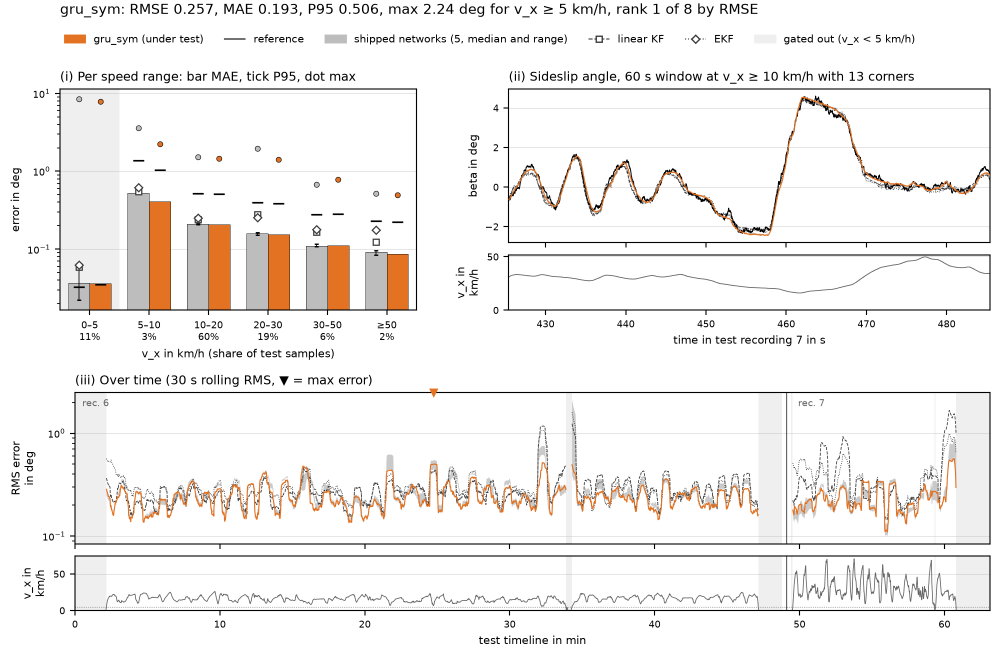

# sideslip_bench
An open-source benchmark for vehicle sideslip angle estimation on ReV-StED: neural networks and
model-based observers under one protocol, with one-call evaluation and a diagnostic report.

<p align="center"></p>

## Install

```bash
uv sync                  # core: data, evaluation, report, observers and their tuning (numpy, h5py, pandas, matplotlib, numba); no torch
uv sync --extra train    # + torch 2.12.0 and tsfast, pinned to the versions the paper used: training and the networks
uv sync --extra tune     # + Ray Tune: hyperparameter search for the networks
uv run pytest            # self-checks (pytest is a dev dependency, installed by uv sync)
```

Python 3.11–3.13; `.python-version` makes uv use 3.13 (the `train` and `tune` extras do not build on
3.14, because a transitive dependency of tsfast ships only a source package that fails there). The
core install also runs on 3.14. Everything runs from a clone of this repository: the configs, trained
weights and bundled predictions are files in it.

## Rules

1. The test split never enters any decision: training, tuning, model and seed selection use the
   training and validation splits only.
2. An estimator runs causally, every test recording as one sequence from its first sample.
3. Its inputs are the CAN channels of the chosen input set (`u=1`: the nine signals below), never
   the Correvit or ADMA references.
4. The first 20 samples of every test recording are not scored (warm-up).
5. The metrics count only samples with v_x >= 5 km/h on the speedometer.
6. Neural methods are reported as the median over at least three seeds fixed before training; no
   run is discarded or selected, and an ensemble of runs does not count as one method.

## Data

```python
import sideslip_bench as ssb

recs = ssb.load("train")     # {"ReVSTED_recording_1.h5": pandas.DataFrame, ...}, 50 Hz
```

The first call downloads the seven recordings from [Zenodo](https://zenodo.org/records/15270060)
into `data/revsted/raw_csv/`, applies the unit conversions, splits them time-continuously
70/10/20 (recordings 1–7 concatenated, then cut; each recording portion is its own HDF5 file in
`data/revsted/{train,valid,test}/`, so no window spans a join) and checks the result against the
frozen split in `results/split_manifest.json` (file list, sample counts and per-column statistics).
Later calls only read the HDF5 files. `ssb.evaluate` does the same on first use.

Each table holds the nine CAN channels an estimator may use (input set `u=1`), the Correvit
target `sideslip_angle_COR_deg`, the ADMA reference `sideslip_angle_ADMA_deg` and `time`;
`ssb.load(split, columns=None)` returns all 78 channels. The same from the command line:

```bash
uv run python scripts/preprocess_data.py               # download, rebuild and verify (rebuilds even if present)
uv run python scripts/make_split_manifest.py --check   # verify only
```

## Evaluate an estimator

One call scores an estimator, compares it with the shipped comparison methods and writes the
standard report to `reports/<name>/` (`report.pdf`/`.png`, `metrics.json`, `row.md`, `row.tex`):

```python
import sideslip_bench as ssb

def my_estimator(rec):          # pandas.DataFrame of the CAN channels of input set `inputs`, 50 Hz
    return 0.0 * rec["speedo_obd"].to_numpy()   # beta in deg for every sample, causal from the first

rep = ssb.evaluate(my_estimator, name="zero")    # or a dict {recording: array}, or a --preds folder
rep["metrics"]["RMSE_g5"], rep["rank"]
```

```bash
uv run python scripts/evaluate.py --preds my_estimator/test --name my_ukf   # score prediction files, write the report
uv run python scripts/evaluate.py --preds my_estimator/test                 # metrics only
```

`--preds` expects one HDF5 file per test recording, named like the recording
(`ReVSTED_recording_6.h5`, `ReVSTED_recording_7.h5`), each holding one 1-D dataset: beta in
degrees for every sample of the recording.

The report shows (i) per speed range the MAE (bar), P95 (tick) and maximum error (dot) of the
estimator next to the median and range of the five shipped networks and the MAE of the two
observers, (ii) beta in the 60 s test window at v_x >= 10 km/h with the most corners (chosen from
the inputs only, so the same window for every estimator) against the reference, and (iii) the 30 s
rolling RMS error over the test timeline. Panels (i) and (ii) are the paper's Fig. 2. Example: the
GRU with built-in symmetry, `ssb.evaluate("results/symmetric_preds/gru", name="gru_sym")`:


 `rank` is the estimator's place
by gated RMSE among the seven shipped comparison models, whose test predictions are bundled in
`results/baseline_preds/` (`manifest.json` holds their scores).

## Comparison methods

Every comparison method runs as an estimator with the same contract as `my_estimator`:

```python
gru = ssb.load_baseline("gru")      # tdnn tcn rnn gru lstm: bundled weights (needs --extra train)
kf = ssb.load_baseline("kf")        # kf ekf: tuned observers (core install)
beta = kf(ssb.load("test")["ReVSTED_recording_7.h5"])
ssb.evaluate(gru, name="gru")       # reproduces the bundled row
```

```bash
uv run python scripts/evaluate.py --baseline ekf --save-preds runs/ekf/preds/test
```

**One shipped model per method.** Every method was trained or tuned with several seeds (networks
0–9, observers 0–2). The shipped model is the seed with the lowest gated RMSE on the validation
split, chosen without looking at the test split. The paper's table reports the **median over all
seeds**; every seed's validation and test scores are in `results/reference_rows.json`.

- **Networks** (`configs/<net>.json`, `weights/<net>.pt`): TDNN, TCN, Elman RNN, GRU and LSTM, the
  champions of one lean search per architecture (`scripts/tune.py`), trained with MAE loss, Adam
  without weight decay, gradient clipping at 1, windows of 400 samples and 100 epochs. A weight file
  is the model's `state_dict` including the input scaler statistics. On a CPU the bundled weights
  reproduce the GPU predictions to within 5e-3 deg per sample and 1e-5 deg RMSE.
  `"sym_wrap": 1` adds built-in left/right mirror symmetry to any of them
  (`sideslip_bench.models.SignAntisymmetricWrapper`: beta(x) = (f(x) − f(Sx))/2, where S negates
  a_y, yaw rate and steering angle and swaps the left and right wheel speeds).
- **Observers** (`sideslip_bench/observers.py`, parameters in `configs/observers/<name>.json`):
  a linear single-track Kalman filter (Leanza et al. 2021) and a single-track EKF with IMU bias
  states. Both use {v_x, steering-wheel angle, yaw rate, a_y} and subtract the steering-wheel zero
  offset of 0.1911 rad (10.9 deg), estimated on the training split.

Test split, v_x >= 5 km/h, in deg. Left: the shipped model; right: median [quartiles] over all seeds, the
numbers of the paper's table.

| method | shipped seed | RMSE | MAE | P95 | MaxE | params | RMSE, median over seeds |
|---|---|---|---|---|---|---|---|
| `tcn` | 6 | 0.268 | 0.200 | 0.529 | 2.34 | 23 233 | 0.270 [0.269, 0.272] (10 seeds) |
| `gru` | 9 | 0.274 | 0.200 | 0.533 | 4.07 | 4 161 | 0.271 [0.268, 0.273] (10 seeds) |
| `lstm` | 2 | 0.301 | 0.202 | 0.527 | 7.56 | 1 745 | 0.273 [0.271, 0.275] (10 seeds) |
| `rnn` | 2 | 0.273 | 0.199 | 0.523 | 3.59 | 21 505 | 0.276 [0.274, 0.279] (10 seeds) |
| `tdnn` | 5 | 0.278 | 0.207 | 0.543 | 2.46 | 24 769 | 0.278 [0.277, 0.279] (10 seeds) |
| `ekf` | 0 | 0.355 | 0.258 | 0.661 | 5.49 |  | 0.361 [0.358, 0.361] (3 seeds) |
| `kf` | 0 | 0.370 | 0.251 | 0.650 | 4.69 |  | 0.370 [0.370, 0.370] (3 seeds) |

### Networks with built-in mirror symmetry

The paper's "+ symmetry" columns: each network config with `"sym_wrap": 1`, trained with the same
ten seeds. Their test predictions (shipped seed = lowest validation RMSE, as above) are bundled in
`results/symmetric_preds/` (`manifest.json`), every seed's scores in
`results/reference_rows_symmetric.json`. Their weights are not included yet; retrain with
`uv run python scripts/train.py configs/gru.json --set sym_wrap=1 --name gru_sym`. The bundled
predictions work like any other estimator's:

```python
ssb.evaluate("results/symmetric_preds/gru", name="gru_sym")   # report of the symmetric GRU (paper Fig. 2)
```

Test split, v_x >= 5 km/h, in deg:

| method | shipped seed | RMSE | MAE | P95 | MaxE | RMSE, median over seeds | MaxE, median over seeds |
|---|---|---|---|---|---|---|---|
| `tcn` + symmetry | 6 | 0.255 | 0.193 | 0.502 | 1.71 | 0.255 [0.253, 0.256] | 1.70 |
| `rnn` + symmetry | 0 | 0.256 | 0.193 | 0.511 | 1.92 | 0.257 [0.254, 0.258] | 1.86 |
| `gru` + symmetry | 6 | 0.257 | 0.193 | 0.506 | 2.24 | 0.257 [0.256, 0.261] | 2.12 |
| `tdnn` + symmetry | 0 | 0.260 | 0.198 | 0.517 | 2.53 | 0.261 [0.261, 0.262] | 2.12 |
| `lstm` + symmetry | 1 | 0.259 | 0.193 | 0.515 | 2.20 | 0.265 [0.260, 0.268] | 2.14 |

## Tuning

**Networks** (`uv sync --extra tune`):

```bash
uv run python scripts/tune.py gru --gpus-per-trial 0.5   # runs/tune_gru/best_config.json
```

Random search with asynchronous successive halving (Ray Tune ASHA, grace period 20 epochs,
reduction factor 2, 100 trials) over the learning rate (log-uniform 3e-4 to 3e-3), the width
{16, 32, 64, 128} and the depth (1–3 layers; TCN 4–7 blocks with kernel 3 or 5; TDNN 1–3 head
layers and a lag window of 5, 10, 20 or 50 samples). Trials are compared by the validation RMSE
on 400-sample windows after their last epoch. Then retrain the champion with ten seeds:

```bash
uv run python scripts/train.py configs/gru.json             # seeds 0-9 -> runs/gru/, summary.json = median and quartiles
uv run python scripts/train.py configs/gru.json --seeds 0 1 2 --set sym_wrap=1 --name gru_sym
uv run python scripts/evaluate.py --run runs/gru/s0         # rebuild a trained model and score it
```

The paper's networks were trained on an NVIDIA L40S GPU with PyTorch defaults (TF32 enabled); one
seed took 3–6 min. On other hardware a seed does not reproduce bit for bit, so compare the median.

**Observers** (core install):

```bash
uv run python scripts/tune_observer.py kf --seeds 0 1 2   # results/observer_tuning/kf_s<seed>.json; 2-5 min per seed on a 15-thread CPU
```

Particle swarm optimisation on the training split (`sideslip_bench/pso.py`): the cost is the
benchmark metric itself (gated RMSE over the training recordings, each run from its first sample,
warm-up 20); the search runs over log10 of every parameter in a fixed box; a global-best swarm of
100 particles × 50 iterations (inertia 0.7, weights 1.4/1.4, positions clipped to the box, a
diverged filter costs +inf); 30 independent swarms per seed, of which the one with the lowest
training cost is kept. The rollouts run in parallel over the particles with numba, in IEEE
arithmetic (no fastmath), so a seed gives the same result on every machine. The script reports
whether the seeds agree on the validation split to within 0.005 deg.

## Protocol

- **Target:** Correvit sideslip angle at the CoG (`sideslip_angle_COR_deg`), predicted directly in degrees.
- **Inputs** (`sideslip_bench/inputs.py`, key `u` in the configs): `1` full CAN, 9 signals (the
  benchmark default: speedometer, steering-wheel angle, yaw rate, lateral acceleration, brake
  pressure, four wheel speeds) · `2` without brake pressure · `3` without speedometer · `9`
  {v_x, delta, yaw rate, a_y} · `7` {v_x, yaw rate, a_y} · `10` {delta, yaw rate, a_y}.
- **Training of the networks:** windows of 400 samples (8 s) with stride 1 from the training
  recordings, 600 random batches of 32 per epoch, flat-then-cosine learning rate, inputs
  standardised with mean and std estimated from 10 random training batches (tsfast default; the
  statistics are stored in the weights). The first `n_skip` = 20 samples of each window are
  excluded from the loss; the model after the last epoch is kept.
- **Test:** each test recording is one sequence from its first sample; the first 20 samples per
  recording are dropped; errors are pooled over the recordings. The metrics (RMSE, MAE, P95 and
  maximum of the absolute error) count only samples with v_x >= 5 km/h on `speedo_obd` (keys
  `*_g5`); the plain keys use all speeds. `metrics.json` carries the protocol version
  `revsted-ssa-1`.

## Configs

Keys: `model`, `u` (input set), `win_sz`, `stp_sz`, `batch_size`, `n_batches_train`, `n_epoch`,
`lr`, `grad_clip`, `n_skip`, `valid_skip`; architecture: `hidden_size`, `num_layers`,
`hidden_layer`, `delay` (TDNN), `tcn_kernel_size`, `tcn_convs_per_block`; `sym_wrap` (built-in
mirror symmetry, 0 or 1). `source` records where the values come from and is not read by the code.

## Structure

```
configs/                  one JSON per network; observers/ = parameters of the shipped observers
docs/                     figures of this README
weights/<net>.pt          weights of the five shipped networks
sideslip_bench/
  data.py                 download, split, verify (manifest) and load ReV-StED: ssb.load
  inputs.py               input sets, target, evaluation constants
  observers.py            linear KF and EKF (numba)
  pso.py                  PSO tuning of the observers
  baselines.py            comparison methods as estimators: ssb.load_baseline
  learner.py              data loaders and model dispatch (tsfast Learner); predict(), load_model()
  models.py               TDNN, TCN, mirror-symmetry wrapper (RNN/GRU/LSTM come from tsfast)
  metrics.py              benchmark metrics, prediction file I/O
  evaluation.py           one-call evaluation against the shipped comparison models: ssb.evaluate
  report.py               standard report figure
scripts/
  preprocess_data.py      download, split and verify ReV-StED
  make_split_manifest.py  freeze (maintainer) or check the split
  tune.py                 lean hyperparameter search for a network (--extra tune)
  train.py                train a network with N seeds and score it
  tune_observer.py        PSO tuning of an observer, one run per seed
  evaluate.py             score predictions, a trained run or a shipped method (--name: standard report)
  bundle_baselines.py     maintainer: choose the shipped models, bundle their predictions, record all seeds
results/
  split_manifest.json     frozen split
  reference_rows.json     validation and test scores of every seed, median and quartiles
  observer_tuning/        PSO records of the observers, one per seed
  baseline_preds/         test predictions of the shipped comparison models + manifest.json
  symmetric_preds/        test predictions of the mirror-symmetric networks + manifest.json
  reference_rows_symmetric.json  their validation and test scores of every seed
tests/                    self-checks (uv run pytest, or uv run python tests/<file>.py)
```

## Citation

If you use this benchmark, please cite the paper (submitted to IFAC SYSID 2027) and the dataset.
GitHub's "Cite this repository" button reads the same entries from `CITATION.cff`.

```bibtex
@unpublished{Schaefke2027SideslipBench,
  author = {Sch{\"a}fke, Hendrik and Weber, Daniel O. M. and Seel, Thomas and Muhmann, Christian and Bank, Dennis and Ehlers, Simon F. G.},
  title  = {An Open-Source Benchmark for Vehicle Sideslip Angle Estimation},
  note   = {Submitted to the 21st IFAC Symposium on System Identification (SYSID 2027)},
  year   = {2026},
}

@misc{ReVStED2025,
  author       = {Kalyanasundaram, A. and Chandra Sekaran, K. and Lange, M. and St{\"a}uber, P. and Utschick, W. and Botsch, M.},
  title        = {Real-world Vehicle State Estimation Dataset ({ReV-StED})},
  howpublished = {Zenodo, dataset, version 1},
  year         = {2025},
  doi          = {10.5281/zenodo.15270060},
}
```

## Not yet included

Trained weights of the mirror-symmetric networks (their test predictions and scores are included),
CPU latency measurement and the figure scripts.
