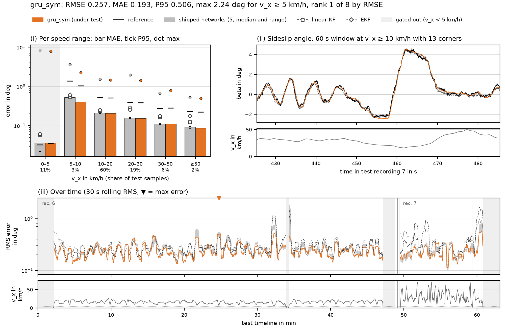

# sideslip_bench in detail

The [README](../README.md) covers the basics. This page has the rest.

- [Install notes](#install-notes)
- [Data](#data)
- [Evaluation](#evaluation)
- [Protocol](#protocol)
- [Comparison methods](#comparison-methods)
- [Networks with built-in mirror symmetry](#networks-with-built-in-mirror-symmetry)
- [Tuning and training](#tuning-and-training)
- [Animation](#animation)
- [Configs](#configs)
- [Repository structure](#repository-structure)

## Install notes

```bash
uv sync                  # core: data, evaluation, report, observers and their tuning (numpy, h5py, pandas, matplotlib, numba); no torch
uv sync --extra train    # + torch 2.12.0 and tsfast, pinned to the versions the paper used: training and the networks
uv sync --extra tune     # + Ray Tune: hyperparameter search for the networks
uv run pytest            # self-checks (pytest is a dev dependency, installed by uv sync)
```

Python 3.11 to 3.13. `.python-version` makes uv use 3.13. The `train` and `tune` extras do not
build on 3.14, because a transitive dependency of tsfast ships only a source package that fails
there; the core install also runs on 3.14. A single self-check runs with
`uv run python tests/<file>.py`.

## Data

```python
import sideslip_bench as ssb

recs = ssb.load("train")     # {"ReVSTED_recording_1.h5": pandas.DataFrame, ...}, 50 Hz
```

The first call downloads the seven recordings from [Zenodo](https://zenodo.org/records/15270060)
into `data/revsted/raw_csv/` and applies the unit conversions. It then splits them
time-continuously 70/10/20: recordings 1 to 7 are concatenated, then cut. Each recording portion
is its own HDF5 file in `data/revsted/{train,valid,test}/`, so no window spans a join. Finally it
checks the result against the frozen split in
[`results/split_manifest.json`](../results/split_manifest.json) (file list, sample counts and
per-column statistics). Later calls only read the HDF5 files. `ssb.evaluate` does the same on
first use.

Each table holds the nine CAN channels an estimator may use (input set `u=1`), the Correvit target
`sideslip_angle_COR_deg`, the ADMA reference `sideslip_angle_ADMA_deg` and `time`.
`ssb.load(split, columns=None)` returns all 78 channels. From the command line:

```bash
uv run python scripts/preprocess_data.py               # download, rebuild and verify (rebuilds even if present)
uv run python scripts/make_split_manifest.py --check   # verify only
```

## Evaluation

`ssb.evaluate(method, name=...)` scores an estimator on the test split, compares it with the
shipped comparison methods and writes the standard report to `reports/<name>/` (`report.pdf`,
`report.png`, `metrics.json`, `row.md`, `row.tex`). `method` is one of:

- a callable `f(rec) -> beta`: `rec` is a `pandas.DataFrame` of the CAN channels of input set
  `inputs` (default 1) at 50 Hz; it returns beta in deg for every sample, causal from the first;
- a dict `{recording file name: array}`;
- a folder of prediction files (below).

`rep["rank"]` is the estimator's place by gated RMSE among the seven shipped comparison models.
Their test predictions are bundled in [`results/baseline_preds/`](../results/baseline_preds/);
`manifest.json` there holds their scores.

The same from the command line:

```bash
uv run python scripts/evaluate.py --preds my_estimator/test --name my_ukf   # score prediction files, write the report
uv run python scripts/evaluate.py --preds my_estimator/test                 # metrics only
```

`--preds` expects one HDF5 file per test recording, named like the recording
(`ReVSTED_recording_6.h5`, `ReVSTED_recording_7.h5`), each holding one 1-D dataset: beta in deg
for every sample of the recording.

The report shows:

- (i) per speed range, the MAE (bar), P95 (tick) and maximum error (dot) of the estimator, next
  to the median and range of the five shipped networks and the MAE of the two observers;
- (ii) beta against the reference in the 60 s test window at v_x ≥ 10 km/h with the most corners
  (chosen from the inputs only, so it is the same window for every estimator);
- (iii) the 30 s rolling RMS error over the test timeline.

Panels (i) and (ii) are the paper's Fig. 2. Example, the GRU with built-in mirror symmetry,
`ssb.evaluate("results/symmetric_preds/gru", name="gru_sym")`:



## Protocol

- **Target:** Correvit sideslip angle at the CoG (`sideslip_angle_COR_deg`), predicted directly in
  degrees.
- **Inputs** ([`sideslip_bench/inputs.py`](../sideslip_bench/inputs.py), key `u` in the configs):
  `1` full CAN, 9 signals (the benchmark default: speedometer, steering-wheel angle, yaw rate,
  lateral acceleration, brake pressure, four wheel speeds) · `2` without brake pressure · `3`
  without speedometer · `9` {v_x, delta, yaw rate, a_y} · `7` {v_x, yaw rate, a_y} · `10`
  {delta, yaw rate, a_y}.
- **Test:** each test recording is one sequence from its first sample. The first 20 samples per
  recording are dropped, and the errors are pooled over the recordings.
- **Metrics:** RMSE, MAE, P95 and maximum of the absolute error, counting only samples with
  v_x ≥ 5 km/h on `speedo_obd` (keys `*_g5`); the plain keys use all speeds. `metrics.json`
  carries the protocol version `revsted-ssa-1`.

## Comparison methods

Every comparison method runs as an estimator with the same contract as your own:

```python
gru = ssb.load_baseline("gru")      # tdnn tcn rnn gru lstm: bundled weights (needs --extra train)
kf = ssb.load_baseline("kf")        # kf ekf: tuned observers (core install)
beta = kf(ssb.load("test")["ReVSTED_recording_7.h5"])
ssb.evaluate(gru, name="gru")       # reproduces the bundled row
```

```bash
uv run python scripts/evaluate.py --baseline ekf --save-preds runs/ekf/preds/test
```

**One shipped model per method.** Every method was trained or tuned with several seeds (networks
0 to 9, observers 0 to 2). The shipped model is the seed with the lowest gated RMSE on the
validation split, chosen without looking at the test split. The paper's table reports the
**median over all seeds**. Every seed's validation and test scores, with median, quartiles and
parameter counts, are in [`results/reference_rows.json`](../results/reference_rows.json) and, for
the mirror-symmetric networks, in
[`results/reference_rows_symmetric.json`](../results/reference_rows_symmetric.json).

**Networks** (`configs/<net>.json`, `weights/<net>.pt`): TDNN, TCN, Elman RNN, GRU and LSTM, the
champions of one lean search per architecture (`scripts/tune.py`). They are trained with MAE
loss, Adam without weight decay, gradient clipping at 1, windows of 400 samples and 100 epochs. A
weight file is the model's `state_dict`, including the input scaler statistics. On a CPU the
bundled weights reproduce the GPU predictions to within 5e-3 deg per sample and 1e-5 deg RMSE.

**Observers** ([`sideslip_bench/observers.py`](../sideslip_bench/observers.py), parameters in
`configs/observers/<name>.json`): a linear single-track Kalman filter (Leanza et al. 2021) and a
single-track EKF with IMU bias states. Both use {v_x, steering-wheel angle, yaw rate, a_y} and
subtract the steering-wheel zero offset of 0.1911 rad (10.9 deg), estimated on the training
split.

## Networks with built-in mirror symmetry

`"sym_wrap": 1` in a network config adds built-in left/right mirror symmetry
(`sideslip_bench.models.SignAntisymmetricWrapper`): beta(x) = (f(x) − f(Sx))/2, where S negates
a_y, yaw rate and steering angle and swaps the left and right wheel speeds.

These are the paper's "+ symmetry" columns: each network config with `"sym_wrap": 1`, trained with
the same ten seeds. The test predictions of their shipped models (lowest validation RMSE, as
above) are bundled in [`results/symmetric_preds/`](../results/symmetric_preds/) with a
`manifest.json`. They work like any other estimator's predictions:

```python
ssb.evaluate("results/symmetric_preds/gru", name="gru_sym")   # report of the symmetric GRU (paper Fig. 2)
```

Retrain them with:

```bash
uv run python scripts/train.py configs/gru.json --set sym_wrap=1 --name gru_sym
```

## Tuning and training

### Networks

Install with `uv sync --extra tune`, then:

```bash
uv run python scripts/tune.py gru --gpus-per-trial 0.5   # runs/tune_gru/best_config.json
```

Random search with asynchronous successive halving (Ray Tune ASHA, grace period 20 epochs,
reduction factor 2, 100 trials) over:

- the learning rate (log-uniform 3e-4 to 3e-3);
- the width {16, 32, 64, 128};
- the depth: 1 to 3 layers; TCN 4 to 7 blocks with kernel 3 or 5; TDNN 1 to 3 head layers and a
  lag window of 5, 10, 20 or 50 samples.

Trials are compared by the validation RMSE on 400-sample windows after their last epoch. Then
retrain the champion with ten seeds:

```bash
uv run python scripts/train.py configs/gru.json             # seeds 0-9 -> runs/gru/, summary.json = median and quartiles
uv run python scripts/train.py configs/gru.json --seeds 0 1 2 --set sym_wrap=1 --name gru_sym
uv run python scripts/evaluate.py --run runs/gru/s0         # rebuild a trained model and score it
```

Training uses windows of 400 samples (8 s) with stride 1 from the training recordings, 600 random
batches of 32 per epoch and a flat-then-cosine learning rate. Inputs are standardised with mean
and std estimated from 10 random training batches (tsfast default; the statistics are stored in
the weights). The first `n_skip` = 20 samples of each window are excluded from the loss. The model
after the last epoch is kept.

The paper's networks were trained on an NVIDIA L40S GPU with PyTorch defaults (TF32 enabled); one
seed took 3 to 6 min. On other hardware a seed does not reproduce bit for bit, so compare the
median.

### Observers

Core install:

```bash
uv run python scripts/tune_observer.py kf --seeds 0 1 2   # results/observer_tuning/kf_s<seed>.json; 2-5 min per seed on a 15-thread CPU
```

Particle swarm optimisation on the training split ([`sideslip_bench/pso.py`](../sideslip_bench/pso.py)):

- **Cost:** the benchmark metric itself, gated RMSE over the training recordings, each run from
  its first sample, warm-up 20.
- **Search space:** log10 of every parameter, in a fixed box.
- **Swarm:** global best, 100 particles × 50 iterations, inertia 0.7, weights 1.4/1.4, positions
  clipped to the box; a diverged filter costs +inf.
- **Restarts:** 30 independent swarms per seed; the one with the lowest training cost is kept.

The rollouts run in parallel over the particles with numba, in IEEE arithmetic (no fastmath), so
a seed gives the same result on every machine. The script reports whether the seeds agree on the
validation split to within 0.005 deg.

## Animation

`scripts/animate.py` renders the bird's-eye GIF of the README for any prediction folder in the
bundle format (`--preds`, `--label`). By default it shows the shipped GRU with built-in mirror
symmetry in the window of the paper's Fig. 2 (test recording 7, 8 s of the 60 s window, real time).
The car is drawn from a small `Vehicle` config: the Smart Fortwo 453 of ReV-StED, or a generic car
of about VW Golf size (`--vehicle generic`). The sideslip angles and the road-wheel angle of
the front tyres are drawn to scale, under a world-fixed 2 m grid. The script
asserts the INS conventions on load (heading = `ins_yaw` + 90°, beta positive left, INS point
0.9 m behind the CoG). The OpenStreetMap background needs `uv sync --extra anim`; tiles are
fetched with the User-Agent `sideslip_bench-animate`, cached in `data/osm_tiles`, and credited in
every frame. `--no-map` works without the extra.

## Configs

Keys: `model`, `u` (input set), `win_sz`, `stp_sz`, `batch_size`, `n_batches_train`, `n_epoch`,
`lr`, `grad_clip`, `n_skip`, `valid_skip`; architecture: `hidden_size`, `num_layers`,
`hidden_layer`, `delay` (TDNN), `tcn_kernel_size`, `tcn_convs_per_block`; `sym_wrap` (built-in
mirror symmetry, 0 or 1). `source` records where the values come from and is not read by the
code.

## Repository structure

```
configs/                  one JSON per network; observers/ = parameters of the shipped observers
docs/                     this page and the README figures
weights/<net>.pt          weights of the five shipped networks
sideslip_bench/
  data.py                 download, split, verify (manifest) and load ReV-StED: ssb.load
  inputs.py               input sets, target, evaluation constants
  observers.py            linear KF and EKF (numba)
  pso.py                  PSO tuning of the observers
  baselines.py            comparison methods as estimators: ssb.load_baseline
  learner.py              data loaders and model dispatch (tsfast Learner); predict(), load_model()
  models.py               TDNN, TCN, mirror-symmetry wrapper (RNN/GRU/LSTM come from tsfast)
  metrics.py              benchmark metrics, prediction file I/O
  evaluation.py           one-call evaluation against the shipped comparison models: ssb.evaluate
  report.py               standard report figure
scripts/
  preprocess_data.py      download, split and verify ReV-StED
  make_split_manifest.py  freeze (maintainer) or check the split
  tune.py                 lean hyperparameter search for a network (--extra tune)
  train.py                train a network with N seeds and score it
  tune_observer.py        PSO tuning of an observer, one run per seed
  evaluate.py             score predictions, a trained run or a shipped method (--name: standard report)
  bundle_baselines.py     maintainer: choose the shipped models, bundle their predictions, record all seeds
  animate.py              bird's-eye animation of an estimator (the README GIF; --extra anim for the map)
results/
  split_manifest.json     frozen split
  reference_rows.json     validation and test scores of every seed, median and quartiles
  observer_tuning/        PSO records of the observers, one per seed
  baseline_preds/         test predictions of the shipped comparison models + manifest.json
  symmetric_preds/        test predictions of the mirror-symmetric networks + manifest.json
  reference_rows_symmetric.json  their validation and test scores of every seed
tests/                    self-checks (uv run pytest, or uv run python tests/<file>.py)
```
